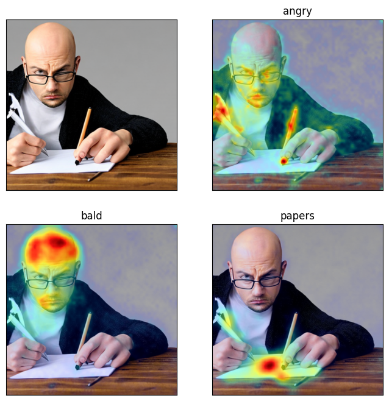

# Example results and provenance

This original figure was extracted from the saved output of cell 6 (zero-based)
in the uploaded `Daam_run_Model.ipynb`. Its source code records the prompt
“An angry, bald man writing papers”, `stabilityai/stable-diffusion-2-base`,
and 20 inference steps. The source does not establish the exact random seed or
installed runtime versions for that output. The figure has not been regenerated
with the revised pipeline. A SHA-256 and source fields are recorded in
`assets/historical_attention.provenance.json`.

## What can be observed

The `bald` map visibly concentrates on the head, and `papers` has a strong
region near the sheet of paper. The `angry` map is more diffuse. This is a
qualitative observation of one saved example, not a benchmark or proof of
semantic understanding. The PNG does not provide raw arrays, so no numerical
IoU score is inferred from it.

The additional uploaded `daam.ipynb` contains a structured walkthrough with
word attribution, per-head maps, adjectival entanglement, and related-object
examples. It is retained as `archive/daam_reference_walkthrough.ipynb` with
outputs cleared and minor seed/generator bugs patched. Its historical DAAM 0.1.0
setup is not the maintained environment.

## How to add a current result

Run the command in the README in a compatible model environment. Review the
result and copy selected output images into `docs/assets/` alongside their
`scores.json`. State the exact model revision, seed, package versions, and
hardware. Do not label synthetic unit-test arrays as model results.
